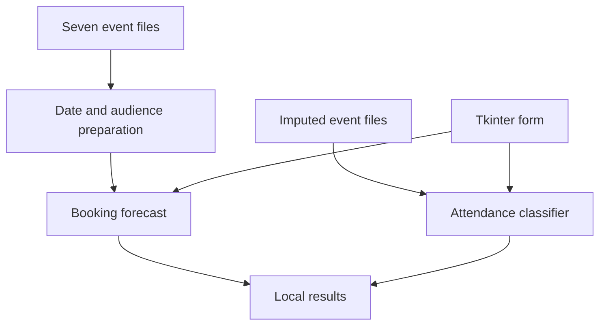

# Engineering and reproducibility notes

## Implemented components

The desktop prototype has three main boundaries. `GUI.py` handles input and presentation. `DataPrep.py` loads the event files and builds day/week aggregates by audience. `FinalModel.py` fits ElasticNet models and calculates forecasts, while `FutureWorkPrediction.py` explores attendance classification. Training runs in the local process when requested; there is no server, database service, persistent model registry or installed application package.



## Environment and outputs

The maintained preparation/forecast path uses the versions bounded in `requirements-maintenance.txt`: pandas, NumPy and scikit-learn. Tkinter is provided by the Python installation. The original exploratory analysis additionally imports matplotlib, SciPy and XlsxWriter. Install those separately only when running that analysis:

```bash
python -m pip install matplotlib scipy XlsxWriter
```

`Data Analysis/dataAnalysis.py` retains its historical absolute CSV path at the end of the file. Change that assignment to a local copy of an event CSV before running it. It writes `Images/<event>.png` and `reports/datareport_<event>.xlsx` beside that input and displays a plot. Keep outputs separate from original evidence. Other experiment scripts have independent assumptions and are not all covered by the maintained GUI dependency list.

## Data contracts and bounded maintenance

The event CSV format has a title row before the header. The explicit file/date manifest must remain aligned: do not replace it with directory enumeration. Dates are day-first in the source. Historical booking records on or after the event date are excluded from the maintained preparation. The seven imputed filenames are case-sensitive on Linux.

Earlier maintenance fixed preparation paths and event ordering. The November 2026 quality update resolves attendance inputs beside `FutureWorkPrediction.py` using the exact committed filename case; it preserves the historical classifier and its predictions. No archive import or scientific method is silently rewritten.

## Checks actually performed

`python -m unittest discover -s tests -v` runs the existing preparation regression. It imports preparation from an unrelated working directory and checks all seven datasets, event-date pairing, datetime preservation, prepared post-event exclusion and finite aggregate data. This passed locally on 14 November 2026 with the bundled Python 3.12/pandas runtime. That runtime lacked scikit-learn, and network package installation failed; model training, attendance classification and the interactive GUI were not executed in this review. The configured CI installs the declared dependencies and runs the preparation regression, but a future CI result must be checked separately.

## Design decisions for further work

Before packaging a desktop release, separate import-time CSV loading and model fitting from the UI, report recoverable errors in the UI, and cache a fitted model by dataset hash and settings. Keep the current archive intact while adding a maintained package in a separate directory. A worker thread or process can prevent training from blocking Tkinter; only the UI thread should update widgets.

Evaluation should hold out entire events and future time periods, fit imputation on training data, document missing-date policy and compare a simple baseline. Record MAE by event and audience and preserve input hashes. Advertising should remain a descriptive proxy unless independent campaign data supports causal analysis. Measure training latency before introducing services or queues; the current project does not need distributed infrastructure to be understandable.

## Evidence and privacy

See `docs/original/README.md` and `PROVENANCE.json` for source and derivative hashes. Public text derivatives omit source document metadata, figures and student identifiers. The professional-contribution excerpt also excludes private peer assessments. Removing an unredacted file from the current branch does not remove earlier Git versions; repository visibility and any history rewrite are separate publication decisions.
